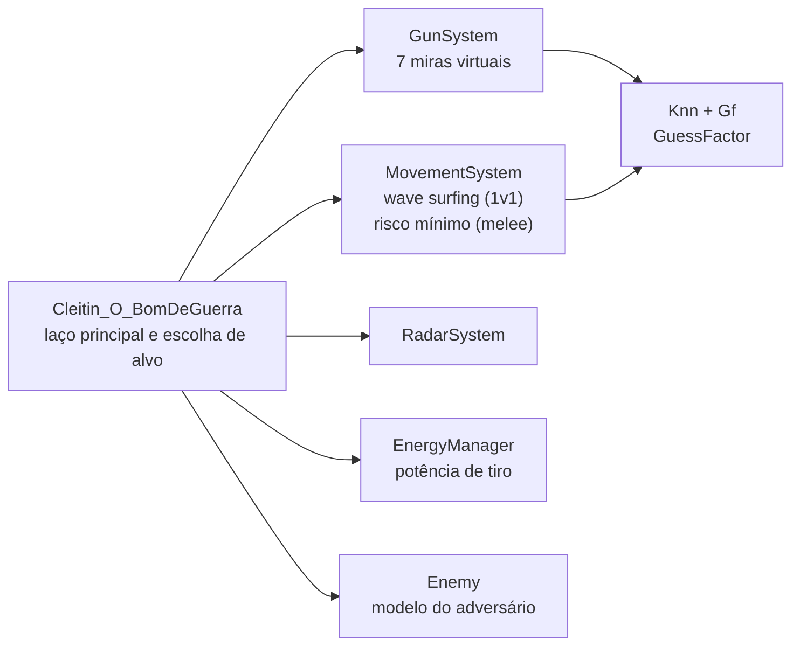

# Cleitin-O-BomDeGuerra

Robô de combate para o **[Robocode](https://robocode.sourceforge.io/) clássico 1.11.1**, escrito em Java 8. Em duelos 1v1 ele faz *wave surfing* (desvia dos tiros do adversário prevendo onde um atirador aprendiz miraria) e atira com sete miras virtuais que ele mesmo avalia durante a batalha. Em melee (vários robôs), usa um movimento de risco mínimo.

[](https://github.com/Rimuro-Sama/RoboCode/actions/workflows/ci.yml)

> **Estado do CI:** os workflows estão no repositório, mas só passam a valer depois do primeiro push na branch `main` do GitHub. O badge acima mostra o resultado real a partir daí.

## O que tem aqui

| Parte | O que faz |
|---|---|
| `src/main/java/cleitin/` | O robô (≈1.800 linhas) |
| `src/test/java/cleitin/*Test.java` | **23 testes unitários** (matemática do Robocode, histogramas GuessFactor, KNN) |
| `src/test/java/cleitin/DuelTest.java` | **7 testes de batalha reais**: o robô precisa vencer adversários de perfis diferentes e ser reconhecido pelo Robocode com o descritor correto |
| `src/test/java/cleitin/BenchmarkTest.java` | Bateria longa contra 19 adversários e 2 cenários de melee, com relatório em Markdown e CSV |
| `src/test/java/tst/` | 9 adversários de teste escritos para este projeto (de simples a "fortes") |
| `.github/workflows/` | CI a cada push e benchmark sob demanda/semanal |
| `docs/` | Relatório técnico, relatório de testes e análise comparativa |

## Como rodar

Requer um JDK moderno e Maven (testado com **JDK 21**; o código é compilado para bytecode Java 8). Não precisa instalar o Robocode: os testes baixam o motor pelo Maven e rodam as batalhas sem interface gráfica.

```bash
mvn verify                                  # compila, roda os 30 testes e gera o jar do robô
mvn test -Pbenchmark                        # bateria longa (20 rounds por confronto)
mvn test -Pbenchmark -Dbenchmark.rounds=35  # 35 rounds, como no RoboRumble
```

O resultado do benchmark fica em `target/benchmark/resultados.md` e `resultados.csv`.

### Usar o robô no Robocode

`mvn verify` gera `target/cleitin.Cleitin_O_BomDeGuerra_1.4.jar`. Copie o arquivo para a pasta `robots/` da sua instalação do Robocode 1.11.1 e reinicie. O robô aparece como `cleitin.Cleitin_O_BomDeGuerra`.

## Como ele funciona



- **Movimento 1v1:** detecta tiros inimigos pela queda de energia, simula a órbita em cada sentido com a física real do robô e escolhe o lado com menor perigo, onde o "perigo" vem de histogramas aprendidos dos tiros que realmente acertaram ou passaram.
- **Mira:** direta, linear, circular, três GuessFactor e uma KNN. Cada onda de tiro pontua todas as miras ao mesmo tempo, e o robô usa a que mais acerta contra aquele alvo.
- **Energia:** a potência do tiro equilibra dano, velocidade da bala e risco de se desabilitar.

Detalhes e justificativas em [`docs/RELATORIO_TECNICO.md`](docs/RELATORIO_TECNICO.md).

## Resultados

### Execução de hoje (benchmark deste repositório, 10 rounds por confronto)

Rodei `mvn test -Pbenchmark -Dbenchmark.rounds=10` numa máquina Linux com JDK 21. Resumo:

| Perfil do adversário | Resultado |
|---|---|
| Robôs de exemplo do Robocode (parado, paredes, giratório, imprevisível, seguidor...) | 10/10 rounds contra todos, 95 a 100% da pontuação |
| `tst.GFBot` (mira GuessFactor) | 10/10, ≈90% |
| `tst.Strafer` | 9/10, ≈86% |
| **`tst.SurfGF`** (surfista com mira GuessFactor, o mais forte) | **7/10, ≈69%** |
| `tst.Sniper` (longa distância) | 8/10, ≈70% |
| Melee, 5 robôs de exemplo | 10/10 rounds em 1º, ≈57% da pontuação |
| Melee contra os 5 adversários fortes | 9/10 rounds em 1º, ≈45% |

Com 10 rounds a margem de erro é grande. Os números mudam a cada execução (o Robocode é aleatório) e dependem da máquina.

### Medições anteriores (35 a 150 rounds)

O [relatório de testes](docs/RELATORIO_DE_TESTES.md) traz os experimentos completos feitos no Windows antes da migração para Maven, incluindo comparações A/B (por exemplo, o surf reduz a taxa de acerto do `GFBot` de 20,5% para 7,0%). Os dados brutos estão em [`docs/resultados-anteriores/`](docs/resultados-anteriores/).

## O que foi (e o que não foi) verificado

**Verificado, rodando de verdade:**
- `mvn verify`: 30 testes passando em execuções repetidas.
- Os testes detectam regressões: quebrei de propósito a fórmula de dano (2 testes falharam) e a política de tiro, fazendo o robô nunca atirar (3 testes de batalha falharam), e depois restaurei o código.
- O conteúdo do `.jar` gerado roda uma batalha completa sozinho (10/10 contra `sample.Walls`).

**Não verificado:**
- **Os workflows do GitHub Actions ainda não rodaram no GitHub.** Os mesmos comandos funcionam localmente.
- **O `.jar` não foi testado instalado numa instalação completa do Robocode** (só com o motor montado pelo Maven, que não consegue ler arquivos `.jar` na pasta de robôs).
- Não foi testado contra robôs de ranking do RoboRumble, nem na interface gráfica, nem em máquinas mais lentas.

## Limitações conhecidas

- Os limites dos testes de batalha são folgados de propósito: o Robocode tem aleatoriedade, e eles servem para pegar regressões graves, não pequenas variações.
- Não há *bullet shadows* nem modelo do tipo de mira do adversário (veja "Melhorias futuras" no relatório técnico).
- Os adversários de teste foram escritos por mim; contra robôs de alto nível o desempenho é desconhecido.

## Sobre o desenvolvimento

Projeto pessoal de estudo, feito por mim com apoio do Claude Code para código, testes e revisão. As medições em `docs/` são de execuções reais; as decisões de projeto e os experimentos A/B são descritos nos relatórios.
